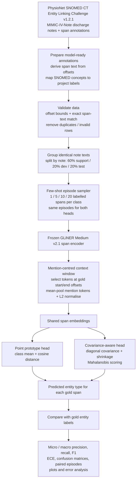

# Clinical NER: Variance-Aware Few-Shot Prototypes

A few-shot clinical entity-type classification study using a frozen GLiNER Medium v2.1 span encoder and two prototype heads: a point prototype and a covariance-aware prototype.

> **Evaluation scope:** The reported results are **gold-span entity classification**. Gold annotation start/end offsets supply entity boundaries; GLiNER embeds those spans and the prototype heads predict their entity types. These are **not end-to-end NER span-detection F1** results. The separate native GLiNER extraction code is included but was not run for the reported experiment (`RUN_EXTRACTION=False`).
## Demo
https://ml-project-clinical-ner.vercel.app/

## Results at a glance

The completed held-out experiment contains 50 paired episodes at each shot count. Values are mean micro-F1 across episodes.

| Support examples per entity type | Point prototype micro-F1 | Covariance-aware prototype micro-F1 | Difference |
|---:|---:|---:|---:|
| 1-shot | 53.28% | 53.28% | 0.00 pp |
| 5-shot | 65.44% | 67.59% | +2.15 pp |
| 10-shot | 69.52% | 71.95% | +2.43 pp |
| 20-shot | 71.49% | 74.12% | +2.63 pp |

### Macro-F1

| Shots | Point prototype | Covariance-aware prototype |
|---:|---:|---:|
| 1 | 50.41% | 50.41% |
| 5 | 64.48% | 66.76% |
| 10 | 68.78% | 71.45% |
| 20 | 71.00% | 73.84% |

### Expected Calibration Error (ECE; lower is better)

| Shots | Point prototype | Covariance-aware prototype |
|---:|---:|---:|
| 1 | 0.171 | 0.063 |
| 5 | 0.301 | 0.310 |
| 10 | 0.343 | 0.264 |
| 20 | 0.363 | 0.241 |

The covariance-aware head has higher mean micro-F1 at 5, 10 and 20 shots in this run; both heads are equal at 1 shot. ECE is mixed at 5 shots and lower for the covariance-aware head at 1, 10 and 20 shots. These descriptive results alone do not establish statistical significance; see the paired episode outputs under `results/experiment/test/metrics/`.

### Per-entity F1 at 20 shots

| Entity type | Point prototype | Covariance-aware prototype |
|---|---:|---:|
| Problem | 56.47% | 61.46% |
| Treatment | 71.37% | 73.08% |
| Test | 85.16% | 86.99% |

## Architecture

The following diagram describes the **executed gold-span classification experiment**. Gold annotation offsets identify mention tokens; GLiNER is not independently predicting the evaluated boundaries here.



### How it works

1. Load clinical notes and span annotations.
2. Validate character offsets against the note text; reject invalid and duplicate rows.
3. Split at note level into support, development and test (60/20/20 in the saved run); identical note texts remain together.
4. Use frozen `urchade/gliner_medium-v2.1` to encode each gold mention. A mention-centred context window is built, the tokens corresponding to the supplied gold offsets are selected, mean-pooled and L2-normalised.
5. Sample episodes with 1, 5, 10 or 20 support examples per entity type. Both heads receive identical episodes.
6. Compare a cosine-distance point prototype with a diagonal-covariance, shrinkage-regularised Mahalanobis prototype.
7. Evaluate predicted labels against gold labels and save metrics, calibration outputs, confusion matrices, plots and audit metadata.

Entity types in the saved experiment: `Problem`, `Treatment` and `Test`.

## Dataset provenance and access

The final run is based on the **SNOMED CT Entity Linking Challenge v1.2.1**, hosted by **PhysioNet** (DOI: [10.13026/az93-vm52](https://doi.org/10.13026/az93-vm52)). The 272 discharge summaries are derived from **MIMIC-IV-Note v2.2** and annotated with SNOMED CT concepts.

The saved audit reports 272 notes and 75,490 input annotation rows. After validation, 75,442 annotations remained; 20 text/offset mismatches and 28 duplicate annotation keys were rejected. The saved run uses the three labels `Problem`, `Treatment` and `Test`. **The exact SNOMED `concept_id` → project-label mapping file/script is not present in this bundle**, so the precise label-conversion step is not independently reproducible from this repository alone. Do not infer or invent that mapping from the label names. To reproduce the run exactly, recover the prepared annotation CSV or the original mapping procedure used to create it, then document and include a non-sensitive mapping specification.

**Do not commit `train_notes.csv` or `train_annotations.csv` to a public GitHub repository.** PhysioNet marks the resource as credentialed access, requiring applicable training and a signed Data Use Agreement. The underlying MIMIC-derived notes are subject to access and redistribution restrictions. Obtain the data through the authorised source and follow its current terms. The clinical CSVs are intentionally excluded from this repository.

- Dataset page: https://physionet.org/content/snomed-ct-entity-challenge/1.2.1/
- Dataset DOI: https://doi.org/10.13026/az93-vm52
- Underlying notes: MIMIC-IV-Note v2.2, subject to its credentialing and data-use requirements.

### Required local input files

Place authorised, project-prepared CSVs in `data/raw/`:

```text
data/raw/
├── train_notes.csv
└── train_annotations.csv
```

The executed loader (`src/data/validated.py`) expects:

- `train_notes.csv`: `note_id`, `text`
- `train_annotations.csv`: `note_id`, `start`, `end`, `span`, `entity_type`

**Schema note:** The original PhysioNet annotation file documents `note_id`, `start`, `end` and `concept_id`. This project's loader additionally requires the literal `span` and mapped `entity_type` fields. `span` can be derived from note text and offsets; `entity_type` must be produced by the documented SNOMED-to-project-label mapping. Simply renaming `concept_id` to `entity_type` is incorrect. The original CSVs alone are not sufficient for this loader. The bundle does not contain the exact concept-to-label mapping artefact used to produce the saved `Problem` / `Treatment` / `Test` labels; this must be recovered from the original data-preparation workflow before claiming exact reproducibility.

`data/synthetic/clinical_samples.jsonl` contains synthetic examples for demonstrations/tests only. It is not the clinical dataset and cannot reproduce the reported results.

## Repository structure

```text
gliner-fewshot-ner/
├── configs/                 # Experiment configuration
├── data/
│   ├── README.md            # Dataset provenance, access and expected schema
│   ├── raw/                 # Authorised local CSVs (not committed)
│   ├── synthetic/           # Synthetic examples only
│   └── processed/           # Generated caches (not committed)
├── docs/
│   ├── architecture.mmd     # Editable Mermaid architecture diagram
│   └── Methodology_Clinical_NER.docx
├── notebooks/               # Colab notebook
├── results/
│   ├── experiment/test/     # Main held-out run
│   ├── experiment/dev_*/    # Development runs
│   ├── smoke/               # Smoke-test artefacts
│   └── legacy_previous_dataset/ # Earlier outputs, not headline results
├── scripts/                 # Main pipeline and helper scripts
├── src/                     # Data, models, evaluation and utilities
├── tests/                   # Unit tests
└── verification/             # Validation reports and dataset audit
```

## Setup and running

The project was developed and run in Google Colab. A GPU is recommended for embedding extraction. GLiNER weights are downloaded from Hugging Face on first use and are not bundled here.

### 1. Clone and install

```bash
git clone <YOUR_REPOSITORY_URL>
cd gliner-fewshot-ner
python -m venv .venv
# macOS / Linux: source .venv/bin/activate
# Windows PowerShell: .venv\\Scripts\\Activate.ps1
python -m pip install --upgrade pip
pip install -e .
pip install pytest
```

### 2. Add the authorised dataset

Obtain the PhysioNet data through its official access process. Prepare the model-ready annotation CSV with the required fields above, then place both files in `data/raw/`. Do not commit them.

### 3. Configure and run

Review `configs/default.yaml`. The exact saved held-out configuration is `results/experiment/test/config.yaml`. The saved final run used:

- Encoder: `urchade/gliner_medium-v2.1` (frozen)
- Device: CUDA; context window: 64 tokens
- Shot counts: 1, 5, 10, 20; 50 episodes per shot count
- Query examples: 50 per entity type per episode
- Point head: cosine distance
- Covariance-aware head: diagonal covariance, shrinkage 0.8, regularisation 0.001, Mahalanobis scoring
- Note-level support/dev/test split: 60/20/20

Run the main entry point:

```bash
python scripts/run_pipeline.py
```

The default configuration is a development configuration and writes to `results/dev_default/`. For a new held-out evaluation, use a fresh output directory and explicitly set the desired configuration; do not overwrite the archived final run. The script refuses to reuse an output directory containing `COMPLETE.json`.

For the Colab workflow, open `notebooks/Colab_Run.ipynb` after mounting/placing the authorised data and follow its cells. The saved results can be inspected without rerunning the experiment.

### 4. Run tests

```bash
pytest -q
```

## Results and artefacts

- `results/experiment/test/metrics/all_results.json` — aggregated metrics.
- `results/experiment/test/metrics/episodes_*shot.json` — episode-level metrics.
- `results/experiment/test/metrics/paired_comparison_*shot.json` — paired comparisons.
- `results/experiment/test/plots/` — F1/ECE curves, confusion matrices, calibration and confidence plots.
- `results/experiment/test/config.yaml` — saved final configuration.
- `results/experiment/test/splits.json` — saved note split membership.
- `results/experiment/test/data_audit.json` — data counts and rejected records.
- `results/environment.txt` — captured environment information.

FP/FN exports that may contain clinical snippets are excluded from this public bundle. Earlier outputs under `results/legacy_previous_dataset/` are retained for traceability and must not be mixed with the current results.

## Limitations and interpretation

- Reported F1 is classification of **gold-provided spans**, not end-to-end boundary detection.
- Native GLiNER extraction evaluation was not run for the headline results.
- Separate external validation on another PhysioNet/MIMIC/SNOMED holdout was not run for the reported table.
- The split is note-level; patient-level separation has not been verified.
- The implemented covariance-aware head uses diagonal covariance, shrinkage and Mahalanobis scoring. Although log determinants are calculated/stored, they are not used in prediction; do not describe this as a complete Gaussian log-likelihood classifier.
- ECE is based on saved softmax confidence outputs and should be treated as preliminary.
- The 1-shot point and covariance-aware results are identical in this run.
- The methodology document describes a broader proposed study, including MTSamples and external validation. The bundled headline results correspond to the executed PhysioNet SNOMED challenge-derived gold-span classification run; do not imply every proposed experiment was completed.

## Citation

**Dataset**  
Hardman, W., Banks, M., Davidson, R., Truran, D., Ayuningtyas, N. W., Ngo, H., Johnson, A., & Pollard, T. (2026). *SNOMED CT Entity Linking Challenge (version 1.2.1).* PhysioNet. https://doi.org/10.13026/az93-vm52

**Model**  
Zaratiana, U., Tomeh, N., Holat, P., & Charnois, T. (2024). *GLiNER: Generalist Model for Named Entity Recognition using Bidirectional Transformer.* NAACL 2024. Model: [`urchade/gliner_medium-v2.1`](https://huggingface.co/urchade/gliner_medium-v2.1).

For access, use the official [PhysioNet dataset page](https://physionet.org/content/snomed-ct-entity-challenge/1.2.1/) and comply with its current credentialing and Data Use Agreement requirements.
